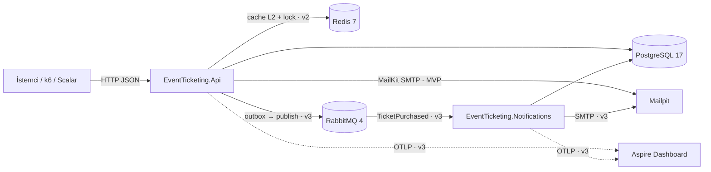

# ISKELET.md — Etkinlik ve Bilet Rezervasyon Sistemi

> Sürüm 1.2 · 2026-10-13 · 1.1: Docker kaldırıldı (K-10) · 1.2: bağımlı servisler Docker Compose ile çalışır (K-10, proje sahibinin kararı)
>
> Bu doküman projenin **tek doğruluk kaynağıdır** (ürün, kapsam, mimari, veri modeli, plan).
> Komutlar ve kod kuralları → `CLAUDE.md`. Agent'ın yetkileri ve çalışma döngüsü → `AGENT.md`.
> Üç dosya çelişirse ürün/kapsam/mimari konusunda bu doküman geçerlidir; çelişki görev raporunda bildirilir.

**Kimlik kuralları:** `F-xx` özellik · `AC-xx.y` kabul kriteri · `NFR-xx` fonksiyonel olmayan gereksinim · `K-xx` kısıt · `R-xx` risk · `V-xx` varsayım · `A-xx` açık nokta · `M#`, `V2-#`, `V3-#`, `B-#` geliştirme görevi.
Her AC en az bir otomatik testle doğrulanır; test, AC kimliğini `[Trait("AC", "AC-08.3")]` ile taşır.

---

## 1. Amaç

Gerçek backend'lerin zor problemlerini — eşzamanlı koltuk alımı, ödeme akışı, zaman aşımına uğrayan rezervasyon, yoğun trafikte cache, mesaj kaybı — çözen, çalıştırılabilir ve testli bir portföy projesi. Mülakatta "İki kullanıcı aynı koltuğu aynı anda alırsa ne olur?" sorusuna kod ve test göstererek cevap verilebilmesi hedeflenir.

**Proje başarı ölçütleri (hepsi sağlanınca proje tamamdır):**
1. Aynı koltuk için 50 paralel istekte tam 1 başarı (AC-08.3); k6 ile 200 sanal kullanıcıda tam 1 başarı (AC-20.4).
2. Temiz klondan, servisler `docker compose up -d` ile başlatıldıktan sonra tek komutla (`dotnet run --project src/EventTicketing.Api`) sistem 120 sn içinde yanıt verir (AC-16.1).
3. GitHub Actions pipeline'ı `main` dalında yeşil (AC-19.1).
4. README; mimari seçim gerekçesini, concurrency çözümünü ve k6 sonuç tablosunu içerir (M9, B-4).

## 2. Hedef kullanıcı

| Kim | Beklentisi |
|---|---|
| Proje sahibi (geliştirici) | Her kararı gerekçeli, mülakatta anlatılabilir kod |
| Mülakatçı / kodu inceleyen mühendis | README'yi okuyup ≤ 10 dakikada sistemi çalıştırmak ve concurrency testini görmek |
| Sistem rolü **Customer** (Müşteri) | Etkinlik arar, koltuk tutar, öder, QR'lı bilet ve e-posta alır |
| Sistem rolü **Organizer** (Organizatör) | Kendi etkinliğini oluşturur, fiyatlandırır, yayımlar, iptal eder |
| Sistem rolü **Admin** | Mekân/salon/koltuk tanımlar, rol atar, tüm kaynaklara erişir |

Arayüz yalnızca HTTP JSON API'dir. Deneme için OpenAPI belgesi (`/openapi/v1.json`) ve Scalar UI (`/scalar`) sunulur. Frontend yoktur.

---

## 3. Kapsam

### 3.1 Aşama özeti

| Aşama | Hedef süre | Özellikler |
|---|---|---|
| MVP | 2–3 hafta | F-01 … F-13 (AC-09.3 hariç), AC-18.1, AC-18.4 |
| v2 | 1,5 hafta | F-14, F-15, F-16, AC-09.3 |
| v3 | 2 hafta | F-17, F-18 (AC-18.2, AC-18.3), F-19 |
| Bonus | 1 hafta | F-20 |

Süreler haftada ~20 saat geliştirme varsayar (V-17).

### 3.2 Kapsam içi özellikler ve kabul kriterleri

Ortak kurallar:
- Yollar `/api/v1` önekiyle sunulur; tablolarda önek yazılmamıştır.
- Aksi yazılmadıkça AC'ler integration testiyle (yerel PostgreSQL sunucusunda gerçek veritabanı) doğrulanır. Bağlantı `EVENTTICKETING_TEST_POSTGRES` ortam değişkeninden okunur; yoksa `Host=localhost;Port=5432;Username=postgres;Password=dev-only-postgres`.
- Zamana bağlı testler `FakeTimeProvider` kullanır; testlerde `Task.Delay` ile gerçek süre beklenmez. `FakeTimeProvider` fixture başlangıcında gerçek UTC zamana ayarlanır; JWT üretimi ve doğrulaması da aynı `TimeProvider`'ı kullanır (§5.11).
- Integration testleri tek bir xUnit collection'ında (`[Collection("Api")]`) sıralı çalışır: test çalıştırması başında yerel sunucuda geçici bir veritabanı (`eventticketing_test_<guid>`) oluşturulur ve sonunda silinir; her test sınıfı başında Respawn ile sıfırlama. Paralel test sınıfları aynı DB'yi paylaşmaz.
- Integration test ortamında `RateLimiting:Enabled = false` ve `MockPayment:LatencyMs = 0`'dır; yalnız AC-20.1 testleri rate limiting'i açar.
- Hata yanıtları §5.12'deki ProblemDetails biçimindedir; AC'lerde geçen `kod` değeri yanıttaki `code` alanıdır.

#### F-01 Kullanıcı kaydı ve girişi (MVP)
- **AC-01.1** `POST /auth/register` geçerli `{email, password, fullName}` → `201 {id, email, fullName, role}`; kullanıcının rolü `Customer`; `fullName` 1–100 karakter; DB'deki `password_hash` gönderilen parolaya eşit değildir ve `PasswordHasher` ile doğrulanır.
- **AC-01.2** Aynı e-posta (büyük/küçük harf farkı dahil) ile ikinci kayıt → `409 auth.email_taken`.
- **AC-01.3** Parola 8 karakterden kısa ya da harf veya rakam içermiyorsa → `400 validation.failed`, `errors.password` dolu. E-posta biçimi geçersizse → `400`, `errors.email` dolu.
- **AC-01.4** `POST /auth/login` doğru bilgilerle → `200 {accessToken, accessTokenExpiresAt, refreshToken}`; access token'da `exp − iat = 900` sn. Yanlış parola ve kayıtlı olmayan e-posta aynı yanıtı döner: `401 auth.invalid_credentials`.

#### F-02 Refresh token (MVP)
- **AC-02.1** Geçerli refresh token ile `POST /auth/refresh` → `200`, yeni access + refresh token; eski refresh token iptal edilir.
- **AC-02.2** İptal edilmiş (kullanılmış) bir refresh token tekrar gönderilirse → `401 auth.refresh_token_reused` ve aynı ailedeki tüm token'lar iptal edilir (az önce verilen yeni token da `401` alır).
- **AC-02.3** 7 günden eski refresh token → `401 auth.refresh_token_expired`. Bilinmeyen token → `401 auth.refresh_token_invalid`.
- **AC-02.4** `POST /auth/logout {refreshToken}` → `204`; aynı token ile refresh → `401`.
- **AC-02.5** DB'de refresh token düz metin olarak bulunmaz: `refresh_tokens.token_hash` istemciye dönen değere eşit değildir ve 64 karakterlik hex SHA-256 değeridir.

#### F-03 Rol bazlı yetki (MVP)
- **AC-03.1** §5.13 tablosundaki her korumalı endpoint için: token yok → `401`; rol yetersiz → `403`. Tablo testte `EndpointAuthorizationMatrix` olarak kodlanır ve parametrik test tüm satırları dolaşır.
- **AC-03.2** Organizer başka organizatörün etkinliğini değiştirmeye çalışırsa → `403 event.not_owner`. Admin her etkinliği değiştirebilir.
- **AC-03.3** Başka kullanıcıya ait rezervasyon veya bilete erişim → `404 resource.not_found` (varlık bilgisi sızdırılmaz). Admin erişebilir.
- **AC-03.4** `PUT /admin/users/{id}/role {role}` Admin tarafından `Customer` ↔ `Organizer` arasında rol değiştirir → `204`. `role = Admin` → `400 user.cannot_assign_admin`. Yeni rol, kullanıcının bir sonraki access token'ında geçerlidir.
- **AC-03.5** Uygulama başlarken `Seed:AdminEmail` / `Seed:AdminPassword` ile Admin kullanıcı yoksa oluşturulur; uygulama ikinci kez başlatıldığında Admin sayısı 1 kalır.

#### F-04 Mekân, salon ve koltuk yönetimi (MVP)
- **AC-04.1** Admin `POST /venues {name, city, address}` → `201`. Organizer ve Customer → `403`.
- **AC-04.2** Admin `POST /venues/{venueId}/halls {name, sections:[{name, rows:[{label, seatCount}]}]}` → `201`; oluşan koltuk sayısı tüm `seatCount` değerlerinin toplamıdır; koltuk numaraları her sırada 1'den başlar.
- **AC-04.3** Bir salonun toplam koltuk sayısı 1–5000 aralığı dışındaysa, aynı salonda aynı bölüm adı veya aynı bölümde aynı sıra etiketi tekrar ediyorsa → `400 validation.failed`.
- **AC-04.4** Salon koltuk düzeni oluşturulduktan sonra değiştirilemez; API'de düzen güncelleme endpoint'i yoktur. `PUT /venues/{id}` yalnız `name, city, address` günceller → `200`.
- **AC-04.5** `GET /venues?city=&page=&pageSize=` sayfalı döner (§5.12 sayfalama kuralları), öğe alanları `{id, name, city, address}`. `GET /venues/{id}` → `200 {id, name, city, address, halls:[{id, name, seatCount}]}`; yoksa `404 resource.not_found`. `GET /halls/{id}` → `200 {id, venueId, name, sections:[{name, rows:[{label, seats:[{id, number}]}]}]}`.

#### F-05 Etkinlik yönetimi (MVP)
- **AC-05.1** Organizer `POST /events {hallId, title, description, category, startsAt, endsAt, sectionPrices:[{section, price}]}` → `201`, `status = Draft`, `organizerId` token'daki kullanıcıdır. `category` ∈ {`Concert`, `Theatre`, `Sports`, `Conference`, `Other`}; başka değer → `400`. `title` 1–200, `description` 0–4000 karakter.
- **AC-05.2** `startsAt ≤ now`, `endsAt ≤ startsAt`, `price ≤ 0` veya `price > 100000` → `400 validation.failed`.
- **AC-05.3** `POST /events/{id}/publish`: salondaki bölümlerden birinin fiyatı tanımlı değilse → `400 event.missing_section_price`; başarılıysa → `200`, `status = Published` ve salondaki her koltuk için bir `event_seats` satırı (`Available`, bölüm fiyatıyla) oluşur. Draft olmayan etkinliği yayımlama → `409 event.invalid_state`.
- **AC-05.4** `PUT /events/{id}`: Draft'ta tüm alanlar güncellenebilir → `200`. Published'da yalnız `title`, `description` güncellenebilir; `hallId`, `startsAt`, `endsAt`, `sectionPrices` değişikliği → `409 event.invalid_state`.
- **AC-05.5** `POST /events/{id}/cancel`: satılmış bilet varsa → `409 event.has_sold_tickets`; yoksa → `200`, `status = Cancelled`, etkinliğin `Pending` rezervasyonları `Cancelled`, koltukları `Available` olur.
- **AC-05.6** `DELETE /events/{id}`: Draft → `204`; diğer durumlar → `409 event.invalid_state`.

#### F-06 Etkinlik listeleme, filtreleme, arama (MVP)
- **AC-06.1** `GET /events` yalnız `Published` ve `startsAt > now` etkinlikleri döner; yanıt `{items, page, pageSize, totalCount, totalPages}`.
- **AC-06.2** `pageSize` varsayılan 20, en fazla 100; `pageSize > 100`, `pageSize < 1` veya `page < 1` → `400 validation.failed`.
- **AC-06.3** Filtreler `city`, `category`, `from`, `to` (`startsAt` aralığı, uçlar dahil) ve `q` (başlıkta büyük/küçük harf duyarsız "içerir"). Filtreler AND ile birleşir; her filtre için en az bir integration testi vardır.
- **AC-06.4** `sort` ∈ {`startsAt` (varsayılan), `-startsAt`, `title`}; ikincil sıralama `id`. Geçersiz değer → `400`. Aynı veri üzerinde ardışık sayfalar arasında tekrar eden veya atlanan kayıt yoktur (test: 45 kayıt, `pageSize = 20`, 3 sayfanın birleşimi 45 tekil id).
- **AC-06.5** `GET /organizer/events` Organizer'a kendi etkinliklerini tüm durumlarda, Admin'e tüm etkinlikleri sayfalı döner.
- **AC-06.6** Liste öğesi alanları: `{id, title, category, startsAt, endsAt, venueName, city, hallName, minPrice}`. `GET /events/{id}` Published etkinlik için → `200 {id, title, description, category, startsAt, endsAt, status, venue:{id, name, city, address}, hall:{id, name}, sectionPrices:[{section, price}]}` (anlık koltuk durumu bu yanıtta yoktur; `GET /events/{id}/seats` kullanılır, böylece detay cache'i koltuk değişikliğinde bayatlamaz). Published olmayan veya var olmayan → `404 resource.not_found`.

#### F-07 Koltuk haritası (MVP)
- **AC-07.1** `GET /events/{id}/seats` her koltuk için `{eventSeatId, section, row, number, price, status}` döner; `status` ∈ {`Available`, `Held`, `Sold`}.
- **AC-07.2** `Held` olup `heldUntil ≤ now` olan koltuk `Available` olarak döner.
- **AC-07.3** Published olmayan veya var olmayan etkinlik → `404 resource.not_found`.

#### F-08 Koltuk tutma — 10 dakikalık geçici kilit (MVP)
- **AC-08.1** Customer `POST /events/{id}/reservations {eventSeatIds}` (1–6 adet) → `201 {reservationId, status: "Pending", expiresAt, totalAmount, seats[]}`; `expiresAt = now + 10 dk`; `totalAmount` koltuk fiyatları toplamıdır; koltuklar `Held` olur.
- **AC-08.2** Koltuklardan biri müsait değilse → `409 seat.unavailable`, yanıtta `unavailableSeatIds`; hiçbir koltuğun durumu değişmez (hepsi ya da hiçbiri).
- **AC-08.3** **Eşzamanlılık:** aynı koltuk için farklı kullanıcılardan 50 paralel istek → tam 1 adet `201`, 49 adet `409 seat.unavailable`; DB'de o koltuğa bağlı tek `Pending` rezervasyon vardır. Test tek çalıştırmada bu senaryoyu 10 tur tekrarlar; 10 turun hepsi geçmelidir.
- **AC-08.4** Kullanıcının aynı etkinlikte süresi dolmamış `Pending` rezervasyonu varken yeni istek → `409 reservation.already_pending`. Süresi dolmuşsa yeni istek `201` döner ve eski rezervasyon `Expired` olur.
- **AC-08.5** 0 veya 7+ koltuk ya da tekrar eden id → `400 validation.failed`; başka etkinliğe ait koltuk id'si → `400 seat.not_in_event`.
- **AC-08.6** Etkinlik `Published` değilse veya `startsAt ≤ now` ise → `409 event.not_on_sale`.
- **AC-08.7** `DELETE /reservations/{id}` (sahibi): `Pending` → `204`, koltuklar `Available`; diğer durumlar → `409 reservation.invalid_state`.

#### F-09 Süresi dolan rezervasyonlar (MVP: anlık kontrol · v2: temizleyici iş)
- **AC-09.1** (MVP) Tutmadan 10 dk + 1 sn sonra, hiçbir arka plan işi çalışmadan, başka kullanıcı aynı koltuğu tutabilir → `201`.
- **AC-09.2** (MVP) Süresi dolmuş `Pending` rezervasyon `GET /reservations/{id}` yanıtında `status: "Expired"` görünür; ödeme denemesi → `409 reservation.expired` ve ödeme ağ geçidi çağrılmaz.
- **AC-09.3** (v2) `ReservationExpiryService` her `Reservations:ExpirySweepIntervalSeconds` (varsayılan 30) saniyede çalışır; bir çalıştırma sonrası süresi dolmuş rezervasyonlar DB'de `Expired`, koltukları `Available` ve `hold_reservation_id`/`held_until` alanları `NULL` olur. Başka bir rezervasyona geçmiş koltuk bu işlemde değişmez. Test, servisin tek çalıştırma metodunu (`SweepOnceAsync`) doğrudan çağırır.

#### F-10 Mock ödeme ve bilet kesimi (MVP)
- **AC-10.1** `POST /reservations/{id}/payments`, `Idempotency-Key: <UUID>` başlığı ve `{paymentToken: "tok_success"}` → `200 {paymentId, status: "Succeeded", tickets[]}`; rezervasyon `Confirmed`, koltuklar `Sold`, koltuk başına 1 bilet.
- **AC-10.2** `paymentToken = "tok_declined"` → `402 payment.declined`; rezervasyon `PaymentFailed`; koltuklar `Available`; `payments` tablosunda `Failed` kaydı.
- **AC-10.3** Aynı `Idempotency-Key` ve aynı rezervasyonla ardışık tekrar istek → ilk yanıtla aynı durum kodu ve gövde (aynı `paymentId`); mock ağ geçidinin `ChargeCount` değeri 1 kalır. Kayıtlı sonuç → yanıt eşlemesi: `Succeeded` → `200` + biletler, `Failed` → `402 payment.declined`, `Refunded` → `409 reservation.expired`. Aynı anahtar farklı rezervasyonla → `422 payment.idempotency_key_reused`. Aynı anahtarla iki **eşzamanlı** istek → ikisi de aynı sonucu döner ve DB'de o anahtarla tek `payments` satırı vardır (ikinci istek §5.7 adım 5'teki `23505` yolunu izler).
- **AC-10.4** `Idempotency-Key` yok veya UUID değil → `400 validation.failed`.
- **AC-10.5** Rezervasyon `Pending` değilse → `409 reservation.invalid_state`; süresi dolmuşsa → `409 reservation.expired`; her iki durumda ağ geçidi çağrılmaz.
- **AC-10.6** Ağ geçidi başarılı döndükten sonra onay kaydı eşzamanlılık çakışmasına düşerse (ör. rezervasyon bu arada süre doldu) → ağ geçidinde `RefundAsync` çağrılır, istekteki `Idempotency-Key` ile `payments` satırı `Refunded` olarak yazılır, yanıt `409 reservation.expired` (rezervasyon `Cancelled` olduysa `409 reservation.invalid_state`). (Test: `ChargeAsync` içinde rezervasyonun `expires_at` değerini geçmişe çeken ve sweeper'ın SQL'ini çalıştıran sahte ağ geçidi.)
- **AC-10.7** `tickets.event_seat_id` benzersizdir: aynı koltuğa ikinci bilet eklemek DB'de `23505` hatası verir (test doğrudan `AppDbContext` ile).

#### F-11 QR kod (MVP)
- **AC-11.1** `GET /tickets/{id}/qr` (sahibi veya Admin) → `200`, `Content-Type: image/png`, gövde PNG imzasıyla (`89 50 4E 47 0D 0A 1A 0A`) başlar.
- **AC-11.2** QR içeriği `ETKT:{ticketCode}` biçimindedir (unit test: üretecin aldığı metin). `ticketCode` 26 karakterlik Crockford Base32, `RandomNumberGenerator` ile üretilir ve DB'de benzersizdir.
- **AC-11.3** Başkasının bileti → `404 resource.not_found`.

#### F-12 E-posta bildirimi (MVP: uygulama içi · v3: F-17'ye taşınır)
- **AC-12.1** Başarılı ödemeden sonra Mailpit'te alıcıya tam 1 e-posta düşer; konu etkinlik başlığını içerir; bilet sayısı kadar `image/png` eki vardır. (Test: yerel Mailpit + Mailpit HTTP API `GET /api/v1/messages`.)
- **AC-12.2** SMTP sunucusuna ulaşılamıyorsa ödeme yanıtı yine `200` döner; `Error` seviyesinde, `reservationId` içeren bir log satırı yazılır.

#### F-13 Rezervasyonlarım ve biletlerim (MVP)
- **AC-13.1** `GET /me/reservations` ve `GET /me/tickets` yalnız çağıran kullanıcının kayıtlarını sayfalı döner; biletlerde etkinlik başlığı, `startsAt`, salon adı ve koltuk etiketi (`{section}-{row}-{number}`) bulunur.
- **AC-13.2** `GET /reservations/{id}` (sahibi veya Admin) rezervasyonu koltuklarıyla döner; durum AC-09.2'deki kurala göre hesaplanır.

#### F-14 Redis distributed lock (v2)
- **AC-14.1** `Locking:Enabled = true` iken AC-08.3 testi geçer ve `seat_hold_concurrency_conflicts_total` sayacı (EF Core `DbUpdateConcurrencyException` sayısı) 0'dır; kaybeden istekler lock alamadığı veya koltuğu `Held` bulduğu için `409` alır.
- **AC-14.2** Lock yalnız sahibi tarafından bırakılabilir: A'nın aldığı lock'u farklı token'la bırakma denemesi `false` döner ve anahtar silinmez.
- **AC-14.3** Redis erişilemezken (test: kapalı bir porta işaret eden bağlantı dizesi) rezervasyon endpoint'i çalışmaya devam eder (doğruluk DB'de korunur, AC-08.3 yine geçer) ve her istekte `Warning` seviyesinde "lock atlandı" logu yazılır.

#### F-15 Cache (v2)
- **AC-15.1** `GET /events/{id}` ikinci çağrıda DB'ye sorgu göndermez (test: EF Core `DbCommandInterceptor` sayacı 0 artar).
- **AC-15.2** `PUT /events/{id}` sonrası ilk `GET /events/{id}` güncel başlığı döner.
- **AC-15.3** Koltuk tutma, iptal, ödeme ve süre dolumu sonrası ilk `GET /events/{id}/seats` güncel durumu döner.
- **AC-15.4** Redis erişilemezken `GET /events` ve `GET /events/{id}` `200` dönmeye devam eder.

#### F-16 Tek komutla yerel çalıştırma (v2)
- **AC-16.1** Temiz klon + `docker compose up -d` ile PostgreSQL ve Redis çalışırken `dotnet run --project src/EventTicketing.Api` → 120 sn içinde `GET http://localhost:8080/api/v1/events` `200` döner; migration'lar ve geliştirme seed verisi otomatik uygulanır (yanıtta en az 1 etkinlik; seed etkinliğinin `startsAt` değeri uygulamanın başladığı andan 30 gün sonrasıdır, böylece AC-06.1 filtresine takılmaz). Doğrulama: `scripts/smoke.sh` (v2'de yazılır, `curl` ile 5 sn aralıkla 24 deneme).
- **AC-16.2** Uygulama durdurulup yeniden başlatıldıktan sonra önceden oluşturulan rezervasyon hâlâ okunabilir (veri PostgreSQL'in Docker volume'ünde kalıcı).

#### F-17 Olay tabanlı bildirim ve outbox (v3)
- **AC-17.1** Başarılı ödemede `TicketPurchased` mesajı ödeme ile aynı DB transaction'ında MassTransit outbox tablosuna yazılır: transaction commit edilirse kayıt vardır, rollback edilirse yoktur.
- **AC-17.2** RabbitMQ durdurulmuşken ödeme `200` döner; RabbitMQ yeniden başlatıldıktan sonra 60 sn içinde e-posta Mailpit'e ulaşır.
- **AC-17.3** Notification servisi aynı `MessageId`'yi iki kez alırsa Mailpit'te tek e-posta olur (MassTransit inbox).
- **AC-17.4** Consumer exception fırlatırsa mesaj 1 sn, 5 sn, 15 sn aralıklı 3 yeniden denemeden sonra `ticket-purchased_error` kuyruğuna düşer.
- **AC-17.5** API projesi SMTP'ye bağlanmaz: v3 sonunda `EventTicketing.Api` içinde `IEmailSender` ve MailKit referansı yoktur (test: assembly referans kontrolü).

#### F-18 Gözlemlenebilirlik (MVP: Serilog konsol · v3: OpenTelemetry)
- **AC-18.1** (MVP) Her istek için bir istek log satırı yazılır (`RequestPath`, `StatusCode`, `Elapsed`, `TraceId` alanlarıyla); ProblemDetails yanıtındaki `traceId` aynı isteğin log satırındaki `TraceId` ile eşittir.
- **AC-18.2** (v3) Tek bir başarılı ödeme, Aspire Dashboard'da API HTTP span'ı, Npgsql span'ları, MassTransit publish span'ı ve Notification servisindeki consume span'ını içeren tek bir trace olarak görünür. (Manuel doğrulama; ekran görüntüsü `docs/observability.png` olarak eklenir.)
- **AC-18.3** (v3) `tickets_sold_total`, `seat_hold_conflicts_total`, `seat_hold_concurrency_conflicts_total`, `reservations_expired_total` metrikleri OTLP ile dışa aktarılır (test: `MeterListener` ile ilgili işlem sonrası sayaç artışı).
- **AC-18.4** (MVP) Loglarda parola, access/refresh token ve `paymentToken` bulunmaz; e-posta maskelenir (`a***@example.com`). (Test: in-memory Serilog sink ile kayıt + giriş + ödeme akışı sonrası log metninde bu değerler aranır.)

#### F-19 CI pipeline (v3)
- **AC-19.1** `.github/workflows/ci.yml`, `main`'e push ve PR'da şu adımları çalıştırır; biri başarısızsa iş kırmızıdır: `dotnet format --verify-no-changes`, Release build (0 uyarı), unit testler, integration testler, coverage eşiği (§4 NFR-05), API ve Notification servisinin `dotnet publish -c Release` çıktısı. PostgreSQL (ve gerekirse Redis, RabbitMQ, Mailpit) GitHub Actions service container'ları olarak, `compose.yaml` ile aynı imaj sürümleriyle başlatılır.
- **AC-19.2** Pipeline toplam süresi `ubuntu-latest` üzerinde ≤ 15 dk.

#### F-20 Bonus: rate limiting, API versioning, health check, yük testi
- **AC-20.1** Rate limiting (`RateLimiting:Enabled = true` iken): `/auth/login` ve `/auth/register` IP başına dakikada 10 istek; 11. istek → `429 rate_limit.exceeded` + `Retry-After` başlığı. `POST /events/{id}/reservations` kullanıcı başına dakikada 30 istek; 31. istek → `429`.
- **AC-20.2** API versioning (`Asp.Versioning.Http`, URL segmenti): yanıtlarda `api-supported-versions: 1.0` başlığı; `/api/v2/...` → `400` ProblemDetails.
- **AC-20.3** Health check: `GET /health/live` bağımlılık kontrolü yapmadan `200`; `GET /health/ready` PostgreSQL, Redis ve RabbitMQ'dan biri erişilemezse `503`, hepsi erişilebilirse `200`.
- **AC-20.4** k6 betikleri: `tests/load/browse.js` (50 VU, 60 sn; `GET /events` ve `GET /events/{id}`) ve `tests/load/hot-seat.js` (200 VU, aynı koltuk, tek iterasyon). `hot-seat` sonunda tam 1 adet `201` vardır. k6 `setup()` aşaması 200 kullanıcıyı kayıt + giriş ile oluşturur; bu yüzden yük testleri `RateLimiting__Enabled=false` ortam değişkeniyle `dotnet run -c Release` ile başlatılan API'ye karşı koşulur (komut README'de). Sonuçlar (p50/p95/p99, RPS, hata oranı, makine özellikleri, `Locking:Enabled` açık/kapalı karşılaştırması) README'de tablo olarak yer alır; NFR-02 hedefleri tutmuyorsa sapma ve nedeni yazılır.

### 3.3 Kapsam dışı

| Madde | Neden |
|---|---|
| Frontend / mobil uygulama | Proje backend becerisini gösterir; Scalar UI yeterli |
| Gerçek ödeme sağlayıcısı, kart verisi işleme | Güvenlik/uyumluluk yükü; mock yeterli (K-08) |
| Satış sonrası iptal ve iade (müşteri tarafı) | Ödeme durum makinesini ikiye katlar |
| Bilet devri, giriş kontrolü (QR okutma/doğrulama endpoint'i) | MVP akışına katkısı yok |
| Koltuksuz (ayakta) etkinlik, dinamik fiyat, indirim kodu, bekleme listesi | Kapsamı büyütür; koltuklu model problemi gösterir |
| Birden fazla para birimi, vergi, fatura | Tek para birimi TRY (V-06) |
| E-posta doğrulama, parola sıfırlama, hesap kilitleme, sosyal giriş, 2FA | Auth kapsamı JWT + refresh ile sınırlı (V-15) |
| SMS/push bildirimi | Yalnız e-posta |
| Satış raporları, organizatör paneli istatistikleri | Raporlama ayrı bir problem alanı |
| Çok kiracılılık, çoklu dil (API mesajları İngilizce) | Gereksiz karmaşıklık |
| API için container imajı (`Dockerfile`), Kubernetes, bulut dağıtımı, üretim ortamı | Yalnız yerel çalıştırma; Docker yalnız bağımlı servisler içindir (K-10) |
| Salon koltuk düzenini sonradan değiştirme | Yayımlanmış etkinlik tutarlılığını bozar (AC-04.4) |

---

## 4. Fonksiyonel olmayan gereksinimler

| Kimlik | Gereksinim | Ölçüm |
|---|---|---|
| NFR-01 | Çift satış olmaz | `tickets.event_seat_id` unique; AC-08.3, AC-10.7, AC-20.4 |
| NFR-02 | Performans (referans makine V-16, yerel çalıştırma, tek API örneği) | k6 `browse`: p95 < 200 ms, hata oranı < %1. `POST /events/{id}/reservations`: p95 < 400 ms. B-4'te ölçülür |
| NFR-03 | Güvenlik | Parola PBKDF2 (`PasswordHasher<T>` varsayılanı); JWT HS256, imza anahtarı ≥ 32 bayt ve yalnız ortam değişkeni/user-secrets'tan; access 15 dk, refresh 7 gün tek kullanımlık; repoda gizli değer yok (AGENT.md yasakları); AC-18.4 |
| NFR-04 | İzlenebilirlik | Her hata yanıtında `traceId` (AC-18.1) |
| NFR-05 | Test kapsamı | `EventTicketing.Api` satır kapsamı ≥ %70 (unit + integration birleşik); v3'te CI'da zorunlu, öncesinde yerelde raporlanır |
| NFR-06 | Kod kalitesi | `TreatWarningsAsErrors=true`, `Nullable=enable`, `dotnet format --verify-no-changes` temiz |
| NFR-07 | Çalıştırılabilirlik | AC-16.1 |
| NFR-08 | Zaman tutarlılığı | Tüm zamanlar UTC `DateTimeOffset` / `timestamptz`; şimdiki zaman yalnız `TimeProvider` ile alınır |

---

## 5. Mimari

### 5.1 Seçim: Vertical Slice Architecture

**Karar:** Tek bir API projesi içinde özellik (use case) bazlı dilimler; v3'te mesaj sözleşmeleri ve bildirim servisi ayrı projeler.

**Gerekçe (README'ye aynen taşınır):**
1. Bu projede değişiklikler use case bazında gelir ("koltuk tutma", "ödeme"). Vertical Slice'ta bir use case'in isteği, doğrulaması, iş mantığı ve endpoint'i tek dosyadadır; değişiklik tek yere dokunur.
2. Concurrency mantığı (lock → transaction → optimistic concurrency → hata eşleme) tek dosyada, yukarıdan aşağı okunabilir. Mülakatta "kodunu göster" denildiğinde tek dosya açılır.
3. Clean Architecture'ın 4 proje + repository + arayüz katmanı, tek geliştiricili ve tek veritabanlı bir projede soyutlama maliyeti getirir; EF Core zaten Unit of Work ve repository işlevi görür.
4. Domain kuralları (durum geçişleri, invariant'lar) yine zengin domain entity'lerinde tutulur; Vertical Slice "her şey handler'da" demek değildir.
5. Geri dönüş maliyeti düşüktür: dilimler ileride ayrı projelere taşınabilir.

**Reddedilen alternatif:** Clean Architecture — katman sınırları net ama bu boyutta proje için ek proje/arayüz sayısı okunabilirliği düşürür.

### 5.2 Bileşenler



### 5.3 Dilim yapısı ve bağımlılık kuralları

Her use case `Features/<Alan>/<UseCase>.cs` içinde tek bir statik sınıftır:

```csharp
public static class CreateReservation
{
    public sealed record Request(IReadOnlyList<Guid> EventSeatIds);
    public sealed record Response(Guid ReservationId, string Status, DateTimeOffset ExpiresAt, decimal TotalAmount, IReadOnlyList<SeatDto> Seats);

    public sealed class Validator : AbstractValidator<Request> { /* kurallar */ }

    // ISeatLockService v2'de eklenir; MVP'de handler yalnız db, clock, options ve logger alır.
    public sealed class Handler(AppDbContext db, TimeProvider clock, ISeatLockService locks, ILogger<Handler> logger)
    {
        public async Task<Result<Response>> HandleAsync(Guid eventId, Guid userId, Request request, CancellationToken ct) { /* … */ }
    }

    public sealed class Endpoint : IEndpoint
    {
        public void Map(IEndpointRouteBuilder app) =>
            app.MapPost("/events/{eventId:guid}/reservations", /* … */)
               .RequireAuthorization(Policies.Customer)
               .AddEndpointFilter<ValidationFilter<Request>>();
    }
}
```

Kurallar:
1. `IEndpoint` uygulamaları ve `Handler` sınıfları başlangıçta reflection ile bulunur ve kaydedilir (`Common/EndpointRegistration.cs`); MediatR kullanılmaz (K-03).
2. Handler'lar `AppDbContext`'i doğrudan kullanır; repository katmanı yoktur. Okuma sorguları `AsNoTracking()` + projeksiyon (`Select`) kullanır.
3. Bir dilim başka bir dilimin `Handler`'ını çağırmaz. Paylaşılan mantık `Domain/` (entity metotları) veya `Infrastructure/` (servis) içine konur.
4. `Domain/` hiçbir `Infrastructure/` veya `Features/` tipine bağımlı olamaz.
5. Beklenen hatalar `Result<T>` / `Error` ile döner, `Common/ResultExtensions` bunları ProblemDetails'e çevirir. Exception yalnız beklenmeyen durumlar içindir.
6. DTO ↔ entity eşlemesi elle yazılır (AutoMapper yok, K-03).

### 5.4 Concurrency stratejisi (çift satışı önleme)

Doğruluğun kaynağı **PostgreSQL**'dir. Üç katman vardır; alttaki katman üsttekiler olmadan da doğruluğu garanti eder.

| Katman | Aşama | Mekanizma | Görevi |
|---|---|---|---|
| 1. Redis lock | v2 | `lock:event-seat:{eventSeatId}`, değer rastgele token, TTL 5 sn, `LockTakeAsync`/`LockReleaseAsync` (StackExchange.Redis) | Sıcak koltukta DB çakışmasını azaltır, kaybedeni DB'ye gitmeden ve beklemeden reddeder. Redis erişilemezse atlanır (fail-open) |
| 2. Optimistic concurrency | MVP | `event_seats.xmin` → EF Core `RowVersion` (`uint`, `IsRowVersion()`); `UPDATE … WHERE xmin = @v` | İki işlem aynı koltuğu okuyup yazarsa ikincisi `DbUpdateConcurrencyException` alır → `409` |
| 3. Unique constraint | MVP | `tickets.event_seat_id` UNIQUE; `ix_reservations_user_event_pending` (partial) | Son savunma hattı: kod hatası olsa bile aynı koltuğa ikinci bilet yazılamaz |

Ayrım: **10 dakikalık tutma** bir iş kuralıdır ve DB'de (`event_seats.held_until`, `reservations.expires_at`) tutulur. **Redis lock** 5 sn'lik teknik bir kritik bölge kilididir; 10 dk'lık tutmayı temsil etmez (V-02).

Birden fazla koltukta lock'lar `eventSeatId` artan sırasıyla alınır (deadlock önleme); biri alınamazsa alınanlar bırakılır ve beklemeden `409 seat.unavailable` döner.

### 5.5 Durum makineleri

```
Reservation:  Pending ──ödeme başarılı──▶ Confirmed
              Pending ──ödeme reddedildi──▶ PaymentFailed
              Pending ──kullanıcı iptali / etkinlik iptali──▶ Cancelled
              Pending ──expires_at ≤ now (lazy veya sweeper)──▶ Expired
              (Confirmed, PaymentFailed, Cancelled, Expired son durumlardır)

EventSeat:    Available ──tut──▶ Held ──ödeme başarılı──▶ Sold
              Held ──iptal / ödeme reddi / süre dolumu──▶ Available
              Held ∧ held_until ≤ now  ≡  Available (okuma ve tutma kontrolünde)

Event:        Draft ──publish──▶ Published ──cancel──▶ Cancelled
              Draft ──delete──▶ (silinir)

Payment:      Succeeded | Failed | Refunded (oluşturulduktan sonra değişmez; Refunded ayrı kayıt olarak yazılır)
```

Geçişler domain entity metotlarıyla yapılır (`reservation.Confirm(now)`, `seat.Hold(reservationId, until)`); geçersiz geçiş `Error` döner.

Okuma kuralı: `status = Pending ∧ expires_at ≤ now` olan rezervasyon API'de `Expired` gösterilir.

### 5.6 Koltuk tutma akışı (`CreateReservation`)

1. İsteği doğrula (1–6 koltuk, tekrar yok).
2. (v2, `Locking:Enabled`) Koltuk lock'larını sıralı al; alınamazsa `409 seat.unavailable`.
3. Açık transaction başlat (`BeginTransactionAsync`, READ COMMITTED).
4. Etkinlik `Published` ve `startsAt > now` değilse → `409 event.not_on_sale`.
5. Kullanıcının bu etkinlikteki `Pending` rezervasyonu: `expires_at > now` ise → `409 reservation.already_pending`; değilse `Expired` yap ve hâlâ ona bağlı koltukları `Available` yap.
6. `event_seats` satırlarını takipli yükle. Biri başka etkinliğe aitse → `400 seat.not_in_event`. `Sold` veya `Held ∧ held_until > now` olan varsa → `409 seat.unavailable` (+ `unavailableSeatIds`).
7. `Reservation(Pending, expires_at = now + HoldMinutes)` ve `reservation_seats` oluştur; koltukları `Held`, `hold_reservation_id`, `held_until = expires_at` yap.
8. `SaveChangesAsync` + commit. `DbUpdateConcurrencyException` → `409 seat.unavailable`; `23505` + `ix_reservations_user_event_pending` → `409 reservation.already_pending`.
9. `finally`: lock'ları bırak. (v2) `event:{id}:seats` cache tag'ini geçersiz kıl.

### 5.7 Ödeme akışı (`PayReservation`)

1. `Idempotency-Key` başlığını doğrula (UUID).
2. `payments.idempotency_key` ile kayıt varsa: aynı rezervasyonsa kayıtlı sonucu AC-10.3'teki eşlemeyle döndür (ağ geçidi çağrılmaz); farklıysa → `422 payment.idempotency_key_reused`.
3. Rezervasyonu yükle (sahibi değilse `404`). `Pending` değilse `409 reservation.invalid_state`; `expires_at ≤ now` ise `409 reservation.expired`.
4. `IPaymentGateway.ChargeAsync(amount, paymentToken, idempotencyKey)` çağır (mock, §5.7.1).
5. **Başarılı:** transaction içinde `Payment(Succeeded)` ekle, `reservation.Confirm()`, koltukları `Sold` yap (her koltukta `hold_reservation_id = reservation.Id ∧ status = Held` kontrolü), koltuk başına `Ticket` ekle, (v3) `TicketPurchased` yayımla (outbox). Commit.
   - Commit `23505` + `ux_payments_idempotency_key` ile başarısız olursa (aynı anahtarla eşzamanlı istek kazanmış): `RefundAsync` çağır, kazanan isteğin kayıtlı sonucunu adım 2'deki eşlemeyle döndür.
   - Commit `DbUpdateConcurrencyException` veya diğer `23505` ile başarısız olursa: `RefundAsync` çağır, yeni transaction'da istekteki `Idempotency-Key` ile `Payment(Refunded)` yaz; rezervasyonu yeniden oku ve `Expired` (veya `expires_at ≤ now`) ise `409 reservation.expired`, aksi halde `409 reservation.invalid_state` dön.
   - (MVP) Commit sonrası e-postayı gönder; hata loglanır, yanıt değişmez (AC-12.2).
6. **Reddedildi:** transaction içinde `Payment(Failed, failure_code)` ekle; rezervasyon ve koltuk güncellemesini koşullu yap (`ExecuteUpdateAsync … WHERE status = 'Pending'` ve `WHERE hold_reservation_id = @id AND status = 'Held'`), böylece eşzamanlı süre dolumu çakışma üretmez. `402 payment.declined` dön.

#### 5.7.1 Mock ödeme ağ geçidi
- `tok_success` → başarılı, `providerReference = "mock_" + Guid`.
- `tok_declined` → `failureCode = "card_declined"`.
- Diğer her değer → `400 validation.failed` (`errors.paymentToken`).
- `MockPayment:LatencyMs > 0` ise her çağrıda o kadar gecikme (`Task.Delay(TimeSpan, TimeProvider)`); varsayılan 200, integration testlerinde 0 (aksi halde `FakeTimeProvider` ilerletilmeden gecikme bitmez).
- `RefundAsync` her zaman başarılı. Çağrı sayıları testte okunabilir (`MockPaymentGateway.ChargeCount`).

### 5.8 Süre dolumu

- **MVP (lazy):** Hiçbir okuma veya yazma `held_until`/`expires_at` geçmişteki bir tutmayı geçerli saymaz (§5.5 okuma kuralı, §5.6 adım 5–6, §5.7 adım 3). Bu, arka plan işi olmadan doğruluğu sağlar.
- **v2 (sweeper):** `ReservationExpiryService : BackgroundService`, `PeriodicTimer` ile her 30 sn:
  1. `status = Pending ∧ expires_at ≤ now` olan en eski 500 rezervasyonun id'lerini al.
  2. Tek transaction'da `ExecuteUpdateAsync` ile: rezervasyonları `Expired` (yalnız hâlâ `Pending` olanları), `hold_reservation_id ∈ ids ∧ status = Held` koltukları `Available` yap.
  3. `reservations_expired_total` sayacını artır, etkilenen etkinliklerin koltuk cache tag'lerini geçersiz kıl.
  4. 500 kayıt dolu geldiyse beklemeden tekrar et.
- Birden fazla API örneğinde eşzamanlı çalışması güvenlidir: `WHERE status = 'Pending'` koşulu işlemi idempotent yapar.
- Hangfire kullanılmaz (V-04).

### 5.9 Cache (v2)

`HybridCache` (L1 bellek + L2 Redis). Cache yalnız **okuma** endpoint'lerinde kullanılır; hiçbir yazma kararı cache'ten okunan veriyle verilmez.

| Veri | Anahtar | TTL (L2) | L1 TTL | Tag | Geçersizleştiren işlemler |
|---|---|---|---|---|---|
| Etkinlik listesi | `events:list:{normalize edilmiş sorgu}` | 60 sn | 10 sn | `events` | Etkinlik create/update/publish/cancel/delete |
| Etkinlik detayı | `events:{id}` | 5 dk | 10 sn | `events`, `event:{id}` | Aynı |
| Koltuk haritası | `events:{id}:seats` | 5 sn | 2 sn | `event:{id}:seats` | Tutma, iptal, ödeme (başarılı/başarısız), süre dolumu, etkinlik iptali |

Çok örnekli senaryoda başka örneğin L1'i en fazla L1 TTL kadar eski kalabilir; bu kabul edilmiştir (koltuk tutma kararı her zaman DB'den verilir). Redis erişilemezse `HybridCache` yalnız L1 ve DB ile çalışır (AC-15.4).

### 5.10 Mesajlaşma ve outbox (v3)

- MassTransit 8.x + RabbitMQ. Sözleşmeler `EventTicketing.Contracts` projesinde:
  ```csharp
  public sealed record TicketPurchased(
      Guid ReservationId, Guid UserId, string Email, string FullName,
      string EventTitle, DateTimeOffset EventStartsAt, string HallName,
      IReadOnlyList<PurchasedTicket> Tickets, DateTimeOffset OccurredAt);
  public sealed record PurchasedTicket(Guid TicketId, string SeatLabel, string TicketCode);
  ```
- API: `AddEntityFrameworkOutbox<AppDbContext>(o => { o.UsePostgres(); o.UseBusOutbox(); })`. `IPublishEndpoint.Publish` ödeme transaction'ı içinde, `SaveChangesAsync`'ten önce çağrılır. Outbox tabloları (`inbox_state`, `outbox_message`, `outbox_state`) migration ile eklenir.
- Notification servisi (`EventTicketing.Notifications`, Worker): `TicketPurchasedConsumer`; receive endpoint `ticket-purchased`; consumer outbox/inbox ile `MessageId` tekilleştirmesi; kendi `NotificationsDbContext`'i aynı PostgreSQL sunucusunda `notifications` şemasında.
- Retry: `UseMessageRetry(r => r.Intervals(1s, 5s, 15s))`; sonrasında `_error` kuyruğu.
- Teslim garantisi: en az bir kez. Notification servisi e-postayı gönderip inbox kaydını commit etmeden çökerse aynı e-posta ikinci kez gidebilir; bu kabul edilmiştir ve README'de anlatılır.

### 5.11 Kimlik doğrulama ve yetkilendirme

- Access token: JWT HS256; `iss`, `aud`, `sub` (userId), `email`, `role`, `jti`; ömür 15 dk; `ClockSkew` 30 sn.
- Zaman tutarlılığı: `TokenService` `iat/nbf/exp` değerlerini `TimeProvider`'dan alır; JwtBearer doğrulamasında `TokenValidationParameters.LifetimeValidator` aynı `TimeProvider` ile `nbf/exp` kontrol eder. Böylece testte `FakeTimeProvider` ilerletildiğinde üretilen token'lar reddedilmez.
- Refresh token: 64 bayt `RandomNumberGenerator`, Base64Url; DB'de SHA-256 hex; ömür 7 gün; her kullanımda döndürülür (rotation). Her token bir `family_id` taşır; iptal edilmiş token tekrar gelirse ailenin tümü iptal edilir (AC-02.2).
- Parola: `Microsoft.Extensions.Identity.Core` içindeki `PasswordHasher<User>` (ASP.NET Core Identity'nin tamamı kullanılmaz).
- E-posta karşılaştırması: `Trim().ToLowerInvariant()` ile normalize edilmiş değer saklanır.
- Policy'ler: `Admin`, `OrganizerOrAdmin`, `Customer`, `CustomerOrAdmin`, `Authenticated`. Kaynak sahipliği (etkinlik, rezervasyon, bilet) handler içinde kontrol edilir.

### 5.12 API kuralları ve hata modeli

- JSON camelCase; enum'lar string; tarih ISO 8601 UTC.
- Sayfalama: `page` (≥ 1, varsayılan 1), `pageSize` (1–100, varsayılan 20). Yanıt: `PagedResponse<T>(Items, Page, PageSize, TotalCount, TotalPages)`.
- Tüm hata yanıtları RFC 9457 ProblemDetails'tir ve şu ek alanları taşır: `code` (makine okunur hata kodu), `traceId`. Doğrulama hatalarında `errors` sözlüğü.
- `IExceptionHandler` beklenmeyen exception'ları `500 server.error` olarak döner, stack trace yanıtta yer almaz; `DbUpdateConcurrencyException` için yedek eşleme `409 concurrency.conflict`.

| code | HTTP | Anlam |
|---|---|---|
| `validation.failed` | 400 | FluentValidation veya parametre hatası |
| `seat.not_in_event` | 400 | Koltuk bu etkinliğe ait değil |
| `event.missing_section_price` | 400 | Yayımlama için bölüm fiyatı eksik |
| `user.cannot_assign_admin` | 400 | API ile Admin rolü atanamaz |
| `auth.invalid_credentials` | 401 | E-posta/parola hatalı |
| `auth.refresh_token_invalid` | 401 | Refresh token bilinmiyor |
| `auth.refresh_token_expired` | 401 | Refresh token süresi dolmuş |
| `auth.refresh_token_reused` | 401 | İptal edilmiş token tekrar kullanıldı; aile iptal edildi |
| `auth.unauthorized` | 401 | Token yok veya geçersiz |
| `payment.declined` | 402 | Mock ödeme reddedildi |
| `auth.forbidden` | 403 | Rol yetersiz |
| `event.not_owner` | 403 | Organizer başkasının etkinliğini değiştiriyor |
| `resource.not_found` | 404 | Kaynak yok veya çağırana ait değil |
| `auth.email_taken` | 409 | E-posta kayıtlı |
| `event.invalid_state` | 409 | Etkinlik durumu işleme uygun değil |
| `event.has_sold_tickets` | 409 | Satış olan etkinlik iptal edilemez |
| `event.not_on_sale` | 409 | Etkinlik satışta değil |
| `seat.unavailable` | 409 | Koltuk tutulu/satılmış |
| `reservation.already_pending` | 409 | Kullanıcının aktif rezervasyonu var |
| `reservation.expired` | 409 | Rezervasyon süresi doldu |
| `reservation.invalid_state` | 409 | Rezervasyon durumu işleme uygun değil |
| `concurrency.conflict` | 409 | Yakalanmamış eşzamanlılık çakışması |
| `payment.idempotency_key_reused` | 422 | Anahtar başka rezervasyonda kullanılmış |
| `rate_limit.exceeded` | 429 | Bonus F-20 |
| `server.error` | 500 | Beklenmeyen hata |

401/403 yanıtları da ProblemDetails biçimindedir (`AddProblemDetails` + status code pages).

### 5.13 Endpoint tablosu

| Metot | Yol (`/api/v1` öneki) | Yetki | Özellik |
|---|---|---|---|
| POST | `/auth/register` | Anonim | F-01 |
| POST | `/auth/login` | Anonim | F-01 |
| POST | `/auth/refresh` | Anonim | F-02 |
| POST | `/auth/logout` | Anonim (refresh token ile) | F-02 |
| PUT | `/admin/users/{id}/role` | Admin | F-03 |
| POST | `/venues` | Admin | F-04 |
| PUT | `/venues/{id}` | Admin | F-04 |
| GET | `/venues` | Anonim | F-04 |
| GET | `/venues/{id}` | Anonim | F-04 |
| POST | `/venues/{id}/halls` | Admin | F-04 |
| GET | `/halls/{id}` | Anonim | F-04 |
| POST | `/events` | OrganizerOrAdmin | F-05 |
| PUT | `/events/{id}` | OrganizerOrAdmin + sahiplik | F-05 |
| POST | `/events/{id}/publish` | OrganizerOrAdmin + sahiplik | F-05 |
| POST | `/events/{id}/cancel` | OrganizerOrAdmin + sahiplik | F-05 |
| DELETE | `/events/{id}` | OrganizerOrAdmin + sahiplik | F-05 |
| GET | `/events` | Anonim | F-06 |
| GET | `/events/{id}` | Anonim | F-06 |
| GET | `/organizer/events` | OrganizerOrAdmin | F-06 |
| GET | `/events/{id}/seats` | Anonim | F-07 |
| POST | `/events/{id}/reservations` | Customer | F-08 |
| GET | `/reservations/{id}` | CustomerOrAdmin + sahiplik | F-13 |
| DELETE | `/reservations/{id}` | Customer + sahiplik | F-08 |
| POST | `/reservations/{id}/payments` | Customer + sahiplik | F-10 |
| GET | `/me/reservations` | Customer | F-13 |
| GET | `/me/tickets` | Customer | F-13 |
| GET | `/tickets/{id}/qr` | CustomerOrAdmin + sahiplik | F-11 |
| GET | `/health/live`, `/health/ready` (önek yok) | Anonim | F-20 |

`GET /events/{id}` Published olmayan etkinlik için `404` döner (Organizer kendi taslağını `GET /organizer/events` ile görür).

### 5.14 Yapılandırma anahtarları

| Anahtar | Varsayılan | Not |
|---|---|---|
| `ConnectionStrings:Postgres` | — | Zorunlu |
| `ConnectionStrings:Redis` | — | v2'den itibaren zorunlu |
| `ConnectionStrings:RabbitMq` | — | v3'ten itibaren zorunlu |
| `Jwt:Issuer` / `Jwt:Audience` | `event-ticketing` | |
| `Jwt:SigningKey` | — | Zorunlu, ≥ 32 bayt. Yerelde user-secrets; `appsettings.Development.json` içinde `dev-only-` önekli, yalnız yerel kullanım için sahte bir değer bulunur (AC-16.1 temiz klonda çalışsın diye); testlerde fixture çalışma anında rastgele üretir |
| `Jwt:AccessTokenMinutes` / `Jwt:RefreshTokenDays` | 15 / 7 | |
| `Reservations:HoldMinutes` | 10 | |
| `Reservations:MaxSeatsPerReservation` | 6 | |
| `Reservations:ExpirySweepIntervalSeconds` | 30 | v2 |
| `Locking:Enabled` / `Locking:TtlSeconds` | true / 5 | v2 |
| `MockPayment:LatencyMs` | 200 | Integration testlerinde 0 |
| `RateLimiting:Enabled` | true | Bonus; integration testlerinde ve k6 koşularında false |
| `Smtp:Host` / `Smtp:Port` / `Smtp:From` | `localhost` / 1025 / `noreply@event-ticketing.local` | Mailpit |
| `Seed:AdminEmail` / `Seed:AdminPassword` | — | Zorunlu. Development'ta `appsettings.Development.json` içinde yalnız yerel kullanım için sahte değerler (`admin@example.com` / `Dev-only-Passw0rd`) |
| `Seed:SampleData` | false; Development'ta true | Örnek mekân, 100 koltuklu salon, 1 Published etkinlik (`startsAt = başlangıç anı + 30 gün`), `organizer@example.com`, `customer@example.com` (parola `Seed:AdminPassword` ile aynı) |
| `Database:MigrateOnStartup` | false; Development'ta true | `dotnet run` varsayılan olarak `Development` ortamında çalışır (`launchSettings.json`); migration, seed ve Scalar açıktır |
| `OTEL_EXPORTER_OTLP_ENDPOINT` | — | v3; boşsa OTLP dışa aktarımı kapalı |

Başlangıçta zorunlu anahtarlar `ValidateOnStart()` ile doğrulanır; eksikse uygulama başlamaz.

Redis bağlantı dizesi `abortConnect=false,connectTimeout=1000,syncTimeout=1000` içerir; böylece Redis kapalıyken (AC-14.3, AC-15.4) istekler bağlantı denemesinde 1 sn'den uzun beklemez.

**Gizli değer tanımı:** gerçek bir ortamda kullanılabilecek her anahtar/parola. `dev-only-` / `Dev-only-` önekli, yalnız yerel Development içindir; repoda bulunabilir. Bu önekli değerler `Production` ortamında başlangıçta reddedilir (`ValidateOnStart`).

### 5.15 Gözlemlenebilirlik

- **MVP:** Serilog konsol çıktısı (Development'ta okunur metin, diğer ortamlarda JSON), `UseSerilogRequestLogging`, `TraceId`/`SpanId` zenginleştirme. Log mesajları message template ile yazılır.
- **v3:** OpenTelemetry tracing (ASP.NET Core, HttpClient, Npgsql, StackExchange.Redis, MassTransit `ActivitySource`) ve metrics (ASP.NET Core, runtime, §AC-18.3 özel sayaçları); Serilog → OTLP sink. Hedef: yerel çalışan Aspire Dashboard (UI `http://localhost:18888`; container'sız kurulum yöntemi A-04).

---

## 6. Veri modeli

PostgreSQL, `snake_case` adlandırma (`EFCore.NamingConventions`), tablo adları çoğul, birincil anahtarlar `uuid` (uygulamada `Guid.CreateVersion7()`), tüm zaman sütunları `timestamptz`, para `numeric(10,2)`, enum'lar `varchar` olarak string.

| Tablo | Sütunlar | Kısıtlar / indeksler |
|---|---|---|
| `users` | `id`, `email varchar(256)`, `password_hash text`, `full_name varchar(100)`, `role varchar(20)`, `created_at` | `ux_users_email` (email) |
| `refresh_tokens` | `id`, `user_id` FK, `token_hash char(64)`, `family_id uuid`, `expires_at`, `created_at`, `revoked_at` null, `replaced_by_token_id` null | `ux_refresh_tokens_token_hash`; `ix_refresh_tokens_family_id` |
| `venues` | `id`, `name varchar(200)`, `city varchar(100)`, `address varchar(500)`, `created_at` | `ix_venues_city` |
| `halls` | `id`, `venue_id` FK, `name varchar(100)`, `created_at` | `ux_halls_venue_id_name` |
| `seats` | `id`, `hall_id` FK, `section varchar(50)`, `row varchar(10)`, `number int` | `ux_seats_hall_section_row_number` |
| `events` | `id`, `organizer_id` FK users, `hall_id` FK, `title varchar(200)`, `description varchar(4000)`, `category varchar(20)`, `starts_at`, `ends_at`, `status varchar(20)`, `created_at`, `updated_at`, `xmin` (RowVersion) | `ix_events_status_starts_at`; `ix_events_organizer_id` |
| `event_section_prices` | `event_id` FK, `section varchar(50)`, `price numeric(10,2)` | PK (`event_id`, `section`) |
| `event_seats` | `id`, `event_id` FK, `seat_id` FK, `price numeric(10,2)`, `status varchar(10)`, `hold_reservation_id` null FK reservations, `held_until` null, `xmin` (RowVersion) | `ux_event_seats_event_id_seat_id`; `ix_event_seats_event_id_status`; `ix_event_seats_hold_reservation_id` |
| `reservations` | `id`, `user_id` FK, `event_id` FK, `status varchar(20)`, `total_amount numeric(10,2)`, `expires_at`, `created_at`, `updated_at`, `xmin` (RowVersion) | `ix_reservations_user_event_pending` UNIQUE (`user_id`, `event_id`) WHERE `status = 'Pending'`; `ix_reservations_status_expires_at` |
| `reservation_seats` | `reservation_id` FK, `event_seat_id` FK, `price numeric(10,2)` | PK (`reservation_id`, `event_seat_id`) |
| `payments` | `id`, `reservation_id` FK, `idempotency_key uuid`, `amount numeric(10,2)`, `status varchar(20)`, `provider_reference varchar(100)` null, `failure_code varchar(50)` null, `created_at` | `ux_payments_idempotency_key`; `ux_payments_reservation_succeeded` UNIQUE (`reservation_id`) WHERE `status = 'Succeeded'` |
| `tickets` | `id`, `reservation_id` FK, `event_seat_id` FK, `user_id` FK, `code char(26)`, `issued_at` | `ux_tickets_event_seat_id`; `ux_tickets_code`; `ix_tickets_user_id` |
| `inbox_state`, `outbox_message`, `outbox_state` | MassTransit şeması | v3, MassTransit migration helper'ları ile |
| `notifications.*` | MassTransit inbox/outbox tabloları | v3, Notification servisinin kendi migration'ları |

Notlar:
- `RowVersion`: `public uint RowVersion { get; private set; }` + `.IsRowVersion()` → Npgsql bunu `xmin` sistem sütununa eşler; migration'da yeni sütun oluşmaz.
- `Refunded` ödeme, isteğin kendi `Idempotency-Key`'i ile yazılan ayrı bir `payments` satırıdır (onay transaction'ı geri alındığı için bu anahtarla başka satır yoktur). Aynı anahtarla tekrar gelen istek bu satırı bulur ve AC-10.3 eşlemesiyle `409 reservation.expired` alır.
- Silme davranışı: domain verisi fiziksel silinmez; yalnız Draft etkinlik (`event_section_prices` ile birlikte) silinir.

---

## 7. Klasör yapısı

```
/
├─ ISKELET.md · CLAUDE.md · AGENT.md · README.md
├─ EventTicketing.slnx
├─ Directory.Build.props        # net10.0, Nullable, ImplicitUsings, TreatWarningsAsErrors, LangVersion latest
├─ Directory.Packages.props     # Central Package Management, sürümler sabit
├─ global.json                  # SDK 10.0.x, rollForward: latestFeature
├─ .editorconfig
├─ .gitignore                   # `dotnet new gitignore` + `.env`
├─ compose.yaml                 # bağımlı servisler: PostgreSQL, Redis, Mailpit, RabbitMQ, Aspire Dashboard (K-10)
├─ LICENSE                      # MIT (V-22)
├─ .config/dotnet-tools.json    # dotnet-ef
├─ scripts/smoke.sh             # v2
├─ .github/workflows/ci.yml     # v3
├─ docs/
│  ├─ decisions.md              # agent'ın karar günlüğü (AGENT.md §8)
│  └─ load-test-results.md      # bonus
├─ src/
│  ├─ EventTicketing.Api/
│  │  ├─ Program.cs
│  │  ├─ Common/                # Result, Error, PagedResponse, IEndpoint, EndpointRegistration,
│  │  │                         # ValidationFilter, GlobalExceptionHandler, ResultExtensions, Policies, ClaimsPrincipalExtensions
│  │  ├─ Domain/                # User, RefreshToken, Venue, Hall, Seat, Event, EventSectionPrice, EventSeat,
│  │  │                         # Reservation, ReservationSeat, Payment, Ticket, enum'lar, DomainErrors
│  │  ├─ Features/
│  │  │  ├─ Auth/               # Register, Login, Refresh, Logout
│  │  │  ├─ Users/              # ChangeRole
│  │  │  ├─ Venues/             # CreateVenue, UpdateVenue, ListVenues, GetVenue, CreateHall, GetHall
│  │  │  ├─ Events/             # CreateEvent, UpdateEvent, PublishEvent, CancelEvent, DeleteEvent,
│  │  │  │                      # ListEvents, GetEvent, ListOrganizerEvents, GetSeatMap
│  │  │  ├─ Reservations/       # CreateReservation, GetReservation, ListMyReservations, CancelReservation,
│  │  │  │                      # ReservationExpiryService (v2)
│  │  │  ├─ Payments/           # PayReservation
│  │  │  └─ Tickets/            # ListMyTickets, GetTicketQr
│  │  └─ Infrastructure/
│  │     ├─ Persistence/        # AppDbContext, Configurations/, Migrations/, Seed/
│  │     ├─ Auth/               # TokenService, JwtOptions, PasswordHashing
│  │     ├─ Payments/           # IPaymentGateway, MockPaymentGateway
│  │     ├─ Qr/                 # QrCodeGenerator (QRCoder)
│  │     ├─ Email/              # IEmailSender, SmtpEmailSender (MVP; v3'te kaldırılır)
│  │     ├─ Caching/            # v2
│  │     ├─ Locking/            # ISeatLockService, RedisSeatLockService (v2)
│  │     ├─ Messaging/          # v3
│  │     └─ Observability/      # Serilog + (v3) OpenTelemetry kurulumu, Metrics
│  ├─ EventTicketing.Contracts/ # v3: TicketPurchased, PurchasedTicket
│  └─ EventTicketing.Notifications/  # v3: Program.cs, Consumers/, Email/, Qr/, Persistence/
└─ tests/
   ├─ EventTicketing.UnitTests/         # Domain/, Features/, Infrastructure/
   ├─ EventTicketing.IntegrationTests/  # Fixtures/ (ApiFactory, PostgresFixture (yerel sunucuda geçici DB), MailpitFixture, AuthHelper), Features/
   └─ load/                             # browse.js, hot-seat.js (bonus)
```

`QrCodeGenerator` Notification servisinde ayrı bir kopya olarak bulunur (≈ 15 satır); paylaşılan kütüphane projesi açılmaz.

---

## 8. Kısıtlar

| Kimlik | Kısıt |
|---|---|
| K-01 | .NET 10 SDK (10.0.x), `net10.0`, C# 14 |
| K-02 | PostgreSQL 17, Redis 7, RabbitMQ 4 (management), Mailpit, Aspire Dashboard; hepsi `compose.yaml` ile Docker'da çalışır, imaj sürümleri orada sabitlenir, kurulum adımları README'de |
| K-03 | Yalnız §8.1'deki paketler; ticari lisanslı sürümler yasak (MediatR, AutoMapper, MassTransit ≥ 9, FluentAssertions ≥ 8) |
| K-04 | Tek repo, tek solution (`EventTicketing.slnx`), Central Package Management |
| K-05 | Zaman: UTC, `DateTimeOffset`, `TimeProvider` (NFR-08) |
| K-06 | Para: `decimal` / `numeric(10,2)`, TRY |
| K-07 | §5.3 bağımlılık kuralları |
| K-08 | Gerçek ödeme sağlayıcısı ve gerçek SMTP sunucusu kullanılmaz; e-postalar yalnız Mailpit'e gider |
| K-09 | Tüm sistem yerel makinede çalışır; bulut hizmeti gerekmez |
| K-10 | Docker yalnız bağımlı servisler için, kökteki `compose.yaml` ile kullanılır; API ve Notification servisi `dotnet run` ile çalışır, `Dockerfile` yoktur. Testcontainers kullanılmaz: integration testleri compose servislerine (aynı portlar) bağlanır ve kendi geçici veritabanını oluşturur |

### 8.1 Onaylı paketler

Sürümler M1'de (v3 paketleri V3-1'de) `Directory.Packages.props` içinde .NET 10 ile uyumlu en güncel kararlı sürüme sabitlenir.

| Amaç | Paket | Aşama |
|---|---|---|
| Auth | `Microsoft.AspNetCore.Authentication.JwtBearer`, `Microsoft.Extensions.Identity.Core` | MVP |
| OpenAPI | `Microsoft.AspNetCore.OpenApi`, `Scalar.AspNetCore` | MVP |
| EF Core | `Npgsql.EntityFrameworkCore.PostgreSQL`, `Microsoft.EntityFrameworkCore.Design`, `EFCore.NamingConventions` | MVP |
| Doğrulama | `FluentValidation`, `FluentValidation.DependencyInjectionExtensions` | MVP |
| Log | `Serilog.AspNetCore`, `Serilog.Sinks.OpenTelemetry` (v3) | MVP / v3 |
| QR | `QRCoder` | MVP |
| E-posta | `MailKit` | MVP |
| Cache / lock | `Microsoft.Extensions.Caching.Hybrid`, `Microsoft.Extensions.Caching.StackExchangeRedis`, `StackExchange.Redis` | v2 |
| Mesajlaşma | `MassTransit`, `MassTransit.RabbitMQ`, `MassTransit.EntityFrameworkCore` (hepsi 8.x) | v3 |
| Telemetri | `OpenTelemetry.Extensions.Hosting`, `OpenTelemetry.Exporter.OpenTelemetryProtocol`, `OpenTelemetry.Instrumentation.AspNetCore`, `OpenTelemetry.Instrumentation.Http`, `OpenTelemetry.Instrumentation.Runtime`, `OpenTelemetry.Instrumentation.StackExchangeRedis`, `Npgsql.OpenTelemetry` | v3 |
| Bonus | `Asp.Versioning.Http`, `AspNetCore.HealthChecks.NpgSql`, `AspNetCore.HealthChecks.Redis`, `AspNetCore.HealthChecks.Rabbitmq` | Bonus |
| Test | `xunit.v3`, `xunit.runner.visualstudio`, `Microsoft.NET.Test.Sdk`, `Microsoft.AspNetCore.Mvc.Testing`, `Respawn`, `Shouldly`, `NSubstitute`, `Microsoft.Extensions.TimeProvider.Testing`, `coverlet.collector` | MVP |
| CI araçları | `dotnet-reportgenerator-globaltool` (coverage birleştirme ve eşik) | v3 |

---

## 9. Geliştirme aşamaları

Görevler sırayla yapılır. Agent bir görevi "Bitti" tanımını (AGENT.md §7) sağladığında kutuyu işaretler. Bir aşamanın **çıkış kriteri** sağlanmadan sonraki aşamaya geçilmez.

### Aşama 1 — MVP (2–3 hafta)
- [x] **M1 İskelet:** git deposu (`git init -b main`, `.gitignore`, `LICENSE`, bu üç doküman ilk commit), solution, `Directory.Build.props`, `Directory.Packages.props`, `global.json`, `.editorconfig`, `.config/dotnet-tools.json`, API + iki test projesi; Serilog; ProblemDetails + `GlobalExceptionHandler`; `Result`/`Error`; `IEndpoint` keşfi; `ValidationFilter`; `/api/v1` route grubu; OpenAPI + Scalar; integration test altyapısı (`ApiFactory`, `PostgresFixture`, Respawn, `AuthHelper`); `docs/decisions.md`. *Çıkış:* `dotnet build -c Release` 0 uyarı; `GET /openapi/v1.json` → 200 integration testi geçer; AC-18.1 testi geçer.
- [x] **M2 Veri modeli:** §6'daki tüm MVP tabloları, entity konfigürasyonları, `InitialCreate` migration'ı, seed (Admin + `Seed:SampleData`). *Çıkış:* boş DB'ye migration uygulanır; AC-03.5 ve AC-10.7 testleri geçer.
- [x] **M3 Auth:** F-01, F-02, F-03 (AC-03.1 matrisi o ana kadar var olan endpoint'lerle; her yeni endpoint matrise eklenir). AC-18.4.
- [x] **M4 Mekân/salon:** F-04.
- [x] **M5 Etkinlik:** F-05, F-06, F-07.
- [x] **M6 Rezervasyon:** F-08, AC-09.1, AC-09.2, AC-13.2, `GET /me/reservations`.
- [x] **M7 Ödeme ve bilet:** F-10, F-11, `GET /me/tickets`.
- [x] **M8 E-posta:** F-12.
- [x] **M9 README v1:** amaç, çalıştırma adımları, mimari seçim gerekçesi (§5.1), concurrency açıklaması (§5.4), endpoint özeti, test çalıştırma.

*MVP çıkış kriteri:* F-01…F-13'ün tüm MVP AC'leri (AC-09.3 hariç) testleri geçer; `dotnet test` tamamen yeşil; satır kapsamı raporlanır (NFR-05 hedefi izlenir, zorunluluk v3'te); README v1 mevcut.

### Aşama 2 — v2 (1,5 hafta)
- [x] **V2-1 Redis + HybridCache:** F-15; yerel Redis kurulumu README'de.
- [x] **V2-2 Distributed lock:** F-14; `Locking:Enabled` bayrağı.
- [x] **V2-3 Sweeper:** AC-09.3; `reservations_expired_total` sayacı (`System.Diagnostics.Metrics`; dışa aktarım v3).
- [x] **V2-4 Yerel çalıştırma:** `launchSettings.json` (Development, port 8080), başlangıçta migration + seed, `scripts/smoke.sh`, README kurulum adımları; F-16.

*v2 çıkış kriteri:* F-14, F-15, F-16, AC-09.3 testleri geçer; MVP testleri hâlâ geçer; README'de Redis lock + cache bölümü.

### Aşama 3 — v3 (2 hafta)
- [x] **V3-1 Outbox:** `EventTicketing.Contracts`, MassTransit + RabbitMQ, EF outbox migration'ı, yerel RabbitMQ kurulumu README'de; AC-17.1.
- [x] **V3-2 Notification servisi:** Worker projesi, consumer, inbox, retry, `dotnet run` ile yerel çalıştırma; API'den e-posta kodunun kaldırılması; AC-17.2–AC-17.5; F-12 testleri Notification servisi üzerinden çalışacak şekilde taşınır.
- [x] **V3-3 Observability:** OpenTelemetry + Aspire Dashboard; AC-18.2, AC-18.3.
- [x] **V3-4 CI:** `.github/workflows/ci.yml`; F-19; NFR-05 eşiği zorunlu.

*v3 çıkış kriteri:* F-17…F-19 sağlanır; CI `main`'de yeşil; README'de outbox ve observability bölümleri.

### Aşama 4 — Bonus (1 hafta)
- [x] **B-1 Rate limiting:** AC-20.1.
- [x] **B-2 API versioning:** AC-20.2.
- [x] **B-3 Health check'ler:** AC-20.3.
- [ ] **B-4 Yük testi:** AC-20.4; `docs/load-test-results.md` + README tablosu.

---

## 10. Riskler

| Kimlik | Risk | Olasılık / Etki | Önlem |
|---|---|---|---|
| R-01 | MVP kapsamı 2–3 haftayı aşar | Orta / Yüksek | Sıralı görevler (§9); kapsam dışı listesi (§3.3); yeni istek ISKELET değişikliği ve onay gerektirir (AGENT.md §4). Kesme kuralı: M7 bitişi 3. haftayı geçerse M8 (F-12, uygulama içi e-posta) atlanır ve e-posta doğrudan v3'te (V3-2) yapılır; karar `docs/decisions.md`'ye yazılır |
| R-02 | Concurrency testleri kararsız (flaky) olur | Orta / Yüksek | İstekler `Barrier` ile aynı anda başlatılır; zaman `FakeTimeProvider`; AC-08.3 10 tur tekrar |
| R-03 | Paket lisanslarının ticarileşmesi | Düşük (önlem sonrası) / Orta | K-03, onaylı liste, CPM ile sürüm sabitleme |
| R-04 | Bir paketin .NET 10 uyumlu sürümü yok (ör. `EFCore.NamingConventions`) | Düşük / Orta | Yedek: `ModelBuilder` üzerinde snake_case dönüştüren 20 satırlık extension; karar `docs/decisions.md`'ye yazılır |
| R-05 | Integration testleri CI'da yavaş veya yerel PostgreSQL yok | Orta / Orta | Collection fixture ile çalıştırma başına tek test DB'si; testler arası Respawn; AC-19.2 süresi izlenir |
| R-06 | Saat/zaman dilimi hataları | Orta / Yüksek | K-05, NFR-08; `DateTime.Now`/`UtcNow` kullanımı yasak (CLAUDE.md) |
| R-07 | MassTransit outbox kurulumu v3 süresini aşar | Orta / Orta | Hazır EF outbox kullanılır; özel outbox yazılmaz |
| R-08 | Redis lock'un doğruluk kaynağı sanılması | Orta / Yüksek | §5.4 açıklaması; fail-open; AC-14.3 |
| R-09 | `HybridCache` tag geçersizleştirmesi beklenen gibi çalışmaz | Düşük / Orta | AC-15.2/15.3 testleri; yedek: anahtar bazlı `RemoveAsync` |
| R-10 | Mock ödeme gerçek dünyadaki belirsiz durumları (timeout) yansıtmaz | Yüksek / Düşük | Kapsam dışı; README'de "gerçek sağlayıcıda ne değişir" notu |
| R-11 | MVP'de e-posta, uygulama commit sonrası çökerse kaybolur | Düşük / Düşük | Bilinçli; v3 outbox çözer; README'de anlatılır |
| R-12 | Coverage eşiği aracının (ReportGenerator) eşik parametresi beklenen gibi çalışmaz | Düşük / Düşük | Yedek: birleşik Cobertura dosyasındaki `line-rate` değerini okuyan kısa shell betiği |

---

## 11. Varsayımlar (önem sırasına göre)

| Kimlik | Varsayım | Değiştirme maliyeti |
|---|---|---|
| V-01 | Mimari: Vertical Slice; tek API projesi, v3'te `Contracts` ve `Notifications` projeleri | Yüksek |
| V-02 | 10 dk'lık tutma DB'de (`held_until`, `expires_at`) saklanır; Redis lock yalnız 5 sn'lik kritik bölge kilididir, doğruluk kaynağı değildir | Yüksek |
| V-03 | Çift satış koruması (xmin + unique) MVP'dedir; yol haritasındaki v2 "concurrency çözümü" Redis lock + ölçüm/kanıt olarak yorumlanmıştır | Orta |
| V-04 | Süre dolumu MVP'de anlık kontrolle (lazy), v2'de `BackgroundService` sweeper ile; Hangfire kullanılmaz (tek periyodik iş için ek şema/panel gereksiz) | Düşük |
| V-05 | Ödeme reddedilince rezervasyon `PaymentFailed` olur ve koltuklar serbest kalır; tekrar deneme yeni rezervasyon gerektirir | Düşük |
| V-06 | Tek para birimi TRY; vergi/fatura yok | Düşük |
| V-07 | Kayıt olan herkes `Customer`; `Organizer` rolünü Admin atar; mekân/salon yönetimi yalnız Admin; koltuk tutmayı yalnız `Customer` yapar | Düşük |
| V-08 | Rezervasyon başına en fazla 6 koltuk; kullanıcı başına etkinlik başına 1 aktif rezervasyon | Düşük (yapılandırma) |
| V-09 | Satış etkinlik başlangıç anında kapanır | Düşük |
| V-10 | Ticari lisanslı paketler kullanılmaz: MediatR ve AutoMapper yerine elle yazım, MassTransit 8.x, FluentAssertions yerine Shouldly | Orta |
| V-11 | E-posta MVP'de uygulama içinde best-effort gönderilir; v3'te outbox + Notification servisine taşınır | Düşük |
| V-12 | Gözlemlenebilirlik hedefi Aspire Dashboard (trace + metric + log tek araç) | Düşük |
| V-13 | API yalnız JSON/HTTP; dokümantasyon OpenAPI + Scalar; API metinleri İngilizce, hata kodları sabit | Düşük |
| V-14 | `/api/v1` öneki ilk günden; `Asp.Versioning` bonus aşamasında eklenir | Düşük |
| V-15 | E-posta doğrulama, parola sıfırlama, hesap kilitleme yok | Düşük |
| V-16 | Referans geliştirme makinesi: 8 çekirdek, 16 GB RAM, yerel PostgreSQL/Redis; NFR-02 hedefleri buna göre | Düşük |
| V-17 | Haftada ~20 saat geliştirme; aşama süreleri buna göre | Düşük |
| V-18 | Yerelde tek API örneği çalışır; tasarım çok örnekli çalışmaya uygundur (lock, sweeper idempotent) | Düşük |
| V-19 | Notification servisi aynı PostgreSQL sunucusunda ayrı şema (`notifications`) kullanır | Düşük |
| V-20 | CI kullanıcının yol haritasına uygun olarak v3'te kurulur; o zamana kadar "Bitti" tanımı yerel komutlarla doğrulanır | Düşük |
| V-21 | Proje/solution adı `EventTicketing`; API portu 8080 (yerel) | Düşük |
| V-22 | Repo GitHub'da public olacak ve MIT lisansı taşıyacak | Düşük |

---

## 12. Açık noktalar

Agent'ı bloklamaz; varsayılan değerle ilerlenir, proje sahibi isterse değiştirir.

| Kimlik | Konu | Varsayılan |
|---|---|---|
| A-01 | Gerçek repo adı ve GitHub sahibi | Çözüldü (2026-10-14): `MuratEfeCamoglu/EventTicketing`; CI badge'i README'de |
| A-02 | k6 sonuçlarının alınacağı makinenin gerçek özellikleri | V-16; ölçüm anındaki gerçek değerler README'ye yazılır |
| A-03 | Organizatör olma başvuru akışı istenecek mi | Hayır; Admin rol atar (V-07) |
| A-04 | Windows'ta Redis 7, RabbitMQ 4 ve Aspire Dashboard'un kurulum yöntemi | Çözüldü (2026-10-13): hepsi `compose.yaml` ile Docker'da (K-10) |
